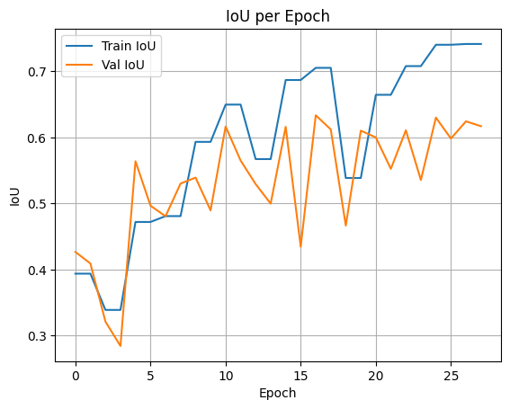
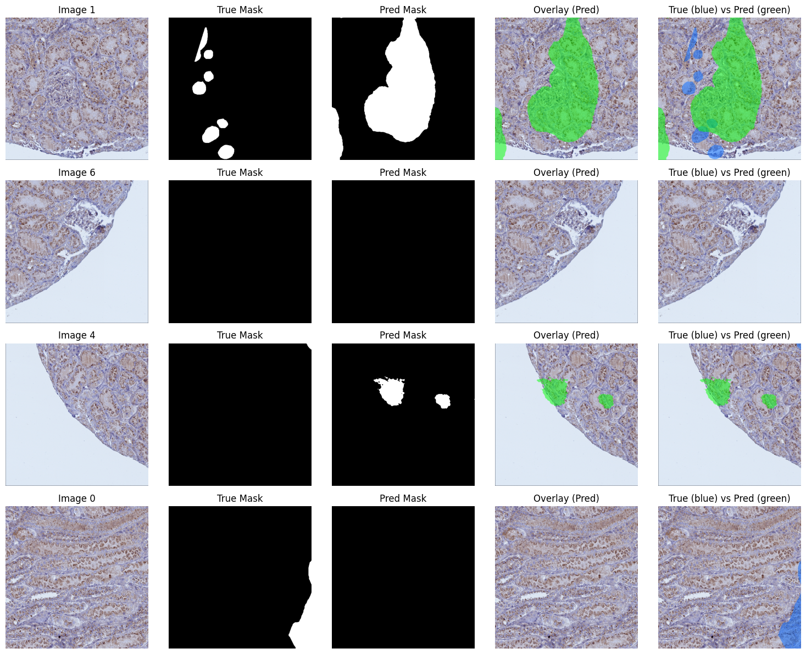

# Biomedical Image Segmentation with PyTorch

Deep learning pipeline for binary segmentation of biomedical images from several organs and imaging modalities. The model uses **SegFormer with an ImageNet-pretrained MiT-B2 encoder** and was developed for the OpenBio image-segmentation competition.

[Open the notebook in Google Colab](https://colab.research.google.com/drive/1kIU4ndTVYtsdVejdR8hsJuy39YEdMrwh#scrollTo=lkcpkPRH0giN)

## Approach

- SegFormer with a MiT-B2 encoder, implemented with `segmentation-models-pytorch`;
- Dice + binary cross-entropy loss for imbalanced foreground masks;
- weighted sampling to reduce imbalance between organ groups;
- Albumentations-based spatial and intensity augmentation;
- mixed-precision training, AdamW, learning-rate scheduling and early stopping;
- patient-level train/validation splitting and test-set inference with RLE submission generation.

## Results

The best checkpoint reached **0.7539 validation IoU**, **0.7386 competition score**.





## Repository structure

```text
notebooks/
  Toma_2026_OpenBio_competition.ipynb
assets/
  training-curves.png
  prediction-overlays.png
requirements.txt
```

## Run the project

Google Colab with a GPU runtime is recommended. 
The original dataset and trained weights are not committed to this repository.

## Tools

Python, PyTorch, SegFormer, MiT-B2, `segmentation-models-pytorch`, Albumentations, OpenCV, NumPy, pandas and Matplotlib.
